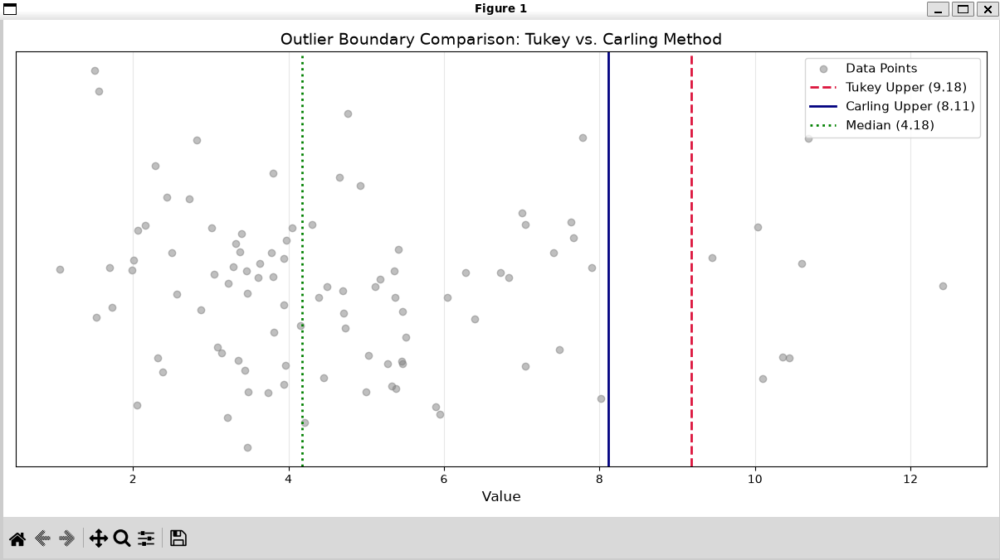

## Overview
In manufacturing processes, vast amounts of data are generated every moment. In semiconductor equipment, not only process variables such as Temperature, Pressure, RF Power, and Gas Flow, but also various quality metrics such as Thickness, Etch Depth, and Resistance are continuously measured.

These data play a crucial role in understanding process conditions and improving quality. However, real-world data are not always clean. Due to sensor errors, equipment malfunctions, process instability, or operator mistakes, values that deviate significantly from the normal distribution can appear, and these are called Outliers.

## Why Are Outliers Important?
Many people simply think of outliers as "incorrectly measured values." However, on the manufacturing floor, this is not necessarily the case.

Outliers can contain the following critical information:

- Sensor malfunction
- Early signs of equipment failure
- Changes in process conditions
- Raw material quality issues
- Emergence of new defect patterns

In other words, outliers are not simply data that must be removed; they can be the very first signal indicating a process anomaly.

For example, a single measurement where RF Power increases significantly above normal could be a measurement error, or it could indicate an issue with the RF Generator or a Matching Network problem.

## Why Outliers Should Not Be Blindly Removed
When starting data analysis, people often try to remove outliers first. However, in manufacturing data, this approach can be risky.

For example, consider the following situations:

- Outliers occur repeatedly on the same equipment starting after a specific Lot.
- Large values appear only in a specific Recipe.
- Outliers are concentrated only in a specific Chamber.

These phenomena are highly likely to indicate a process anomaly.

Therefore, before removing outliers, it is essential to first analyze why they occurred.

## 이상치를 탐지하는 대표적인 방법
| 방법                        | 특징                       |
| ------------------------- | ------------------------ |
| Z-score                   | Based on mean and standard deviation              |
| Modified Z-score          | Based on the median, making it robust to outliers     |
| IQR (Interquartile Range) | Non-parametric method using quartiles         |
| Tukey Method              | Most widely used IQR-based method    |
| Carling Method            | Improved version of Tukey's method that accounts for sample size |

In this post, we will focus on the Tukey Method, which is most widely used in manufacturing data, and the Carling Method, which improves upon it.

### Tukey Method

The Tukey Method is a representative non-parametric statistical technique that detects outliers using quartiles and the Interquartile Range (IQR).

Because it does not rely on the mean or standard deviation, it is less affected by outliers and is widely used in analyzing data whose distribution is difficult to know in advance, such as manufacturing data.

#### Interquartile Range (IQR)

IQR is defined as the difference between the third quartile(\(Q_3\))and the first quartile(\(Q_1\))

$$
IQR = Q_3 - Q_1
$$

여기서

- \(Q_1\) : First quartile (25%)
- \(Q_2\) : Median
- \(Q_3\) : Third quartile (75%)

#### Lower Fence

The lower boundary is calculated as follows:

$$
Lower\ Fence = Q_1 - 1.5 \times IQR
$$

#### Upper Fence

The upper boundary is calculated as follows:

$$
Upper\ Fence = Q_3 + 1.5 \times IQR
$$

#### Outlier Decision Rule

An observation \(x\)is classified as an outlier if it satisfies the following conditions:

$$
x < Q_1 - 1.5 \times IQR
$$

or

$$
x > Q_3 + 1.5 \times IQR
$$

#### Summary

Because the Tukey Method uses only quartiles rather than the mean and standard deviation, it enables relatively stable outlier detection even in datasets that contain outliers.

In particular, it is one of the most widely used outlier detection methods when the data distribution is difficult to assume in advance, such as in manufacturing process data, quality data, and sensor data.


### Carling Method

The Carling Method is an outlier detection technique that improves upon Tukey's Interquartile Range (IQR) method.

While the Tukey Method applies the same \(1.5 \times IQR\) criterion to all datasets, the Carling Method adjusts the outlier detection boundaries by taking the sample size into account.

In particular, for datasets with small to moderate sample sizes, it is known to provide more stable outlier detection than the Tukey Method and is also utilized in manufacturing data analysis and quality control.

#### Interquartile Range (IQR)

The Carling Method also fundamentally uses IQR.

$$
IQR = Q_3 - Q_1
$$

Where:

- \(Q_1\) : First quartile (25%)
- \(Q_2\) : Median
- \(Q_3\) : Third quartile (75%)

#### Carling Correction Factor

Instead of using Tukey's fixed constant, Carling applies the following correction factor depending on the sample size \(n\).

$$
k(n)=\frac{17.63n-23.64}{7.74n-3.71}
$$

#### Lower Boundary

$$
Lower\ Boundary = Q_1 - k(n)\times IQR
$$

#### Upper Boundary

$$
Upper\ Boundary = Q_3 + k(n)\times IQR
$$

#### Outlier Decision Rule

An observation $x$ is classified as an outlier if it satisfies the following conditions:

$$
x < Q_1 - k(n)\times IQR
$$

or

$$
x > Q_3 + k(n)\times IQR
$$

#### Characteristics

Because the Carling Method automatically adjusts the outlier boundaries according to sample size, it can provide more reliable results on smaller samples than the Tukey Method.

On the other hand, when the sample size becomes sufficiently large, it often yields results similar to the Tukey Method.

Therefore, when sample sizes are limited—such as in manufacturing process data, experimental data, and quality data—the Carling Method is used as an outlier detection technique to complement the Tukey Method.


## Example
```python
import numpy as np
import matplotlib.pyplot as plt

# 1. 오른쪽으로 쏠린 가상 데이터 생성 (Log-normal distribution)
np.random.seed(42)
data = np.random.lognormal(mean=1.5, sigma=0.55, size=100)
n = len(data)

# 2. 통계량 산출
median = np.median(data)
q25, q75 = np.percentile(data, [25, 75])
iqr = q75 - q25

# (1) Tukey 방식 경계
tukey_lower = q25 - 1.5 * iqr
tukey_upper = q75 + 1.5 * iqr

# (2) Carling 방식 경계
k = (17.63 * n - 23.64) / (10.72 * n - 17.54)  # n=100일 때 약 1.638
carling_lower = median - k * iqr
carling_upper = median + k * iqr

# 3. 시각화
plt.figure(figsize=(12, 6))

# 데이터 개별 점 및 분포 (Jittering 적용)
y_jitter = np.random.normal(1, 0.04, size=n)
plt.scatter(data, y_jitter, alpha=0.5, color='gray', label='Data Points')

# Tukey 경계선 (Red)
plt.axvline(x=tukey_upper, color='crimson', linestyle='--', linewidth=2, label=f'Tukey Upper ({tukey_upper:.2f})')

# Carling 경계선 (Blue)
plt.axvline(x=carling_upper, color='navy', linestyle='-', linewidth=2, label=f'Carling Upper ({carling_upper:.2f})')

# 데이터 중심 표시 (Median)
plt.axvline(x=median, color='green', linestyle=':', linewidth=2, label=f'Median ({median:.2f})')

plt.title("Outlier Boundary Comparison: Tukey vs. Carling Method", fontsize=14)
plt.xlabel("Value", fontsize=12)
plt.yticks([])
plt.grid(True, alpha=0.3)
plt.legend(fontsize=11)
plt.tight_layout()
plt.show()

```


## Comparison of Tukey Method and Carling Method (Example Above)

The figure above compares the outlier boundaries calculated by the **Tukey Method** and the **Carling Method** on the same dataset.

### Data Distribution

The gray dots represent individual observations.

For example, in a manufacturing process, these could be measurements such as:

- Wafer Thickness
- Etch Rate
- RF Power
- Chamber Pressure
- Temperature

Each dot represents a single measurement data point, and the horizontal axis (X-axis) represents the measured value.

---

### Median

The green dotted line represents the **Median** of the data.

In this example,

$$
Median = 4.18
$$

Because the median is less affected by outliers than the mean, it is frequently used in outlier detection.

---

### Tukey Method

The red dashed line represents the Upper Fence calculated by the Tukey Method.

In this example,

$$
Upper\ Fence = 9.18
$$

That is, data points with

$$
Value > 9.18
$$

are classified as outliers under the Tukey Method.

---

### Carling Method

The blue solid line represents the upper boundary calculated by the Carling Method.

In this example,

$$
Upper\ Boundary = 8.11
$$

That is, data points with

$$
Value > 8.11
$$

are classified as outliers under the Carling Method.

---

### Interpretation of Results

Looking at the plot, the Carling Method boundary is positioned further to the left than the Tukey Method boundary.

In other words, since

$$
8.11 < 9.18
$$

the Carling Method detects more data points as outliers even on the exact same dataset.

For example, if a measured value is

$$
Value = 8.5
$$

Then:

### Tukey Method

$$
8.5 < 9.18
$$

Therefore, it is classified as normal data.

### Carling Method

$$
8.5 > 8.11
$$

Therefore, it is classified as an outlier.

In short, even for the exact same dataset, the results can vary depending on the chosen outlier detection technique.

---

### Why Does This Difference Occur?

The Tukey Method applies the exact same

$$
1.5 \times IQR
$$

criterion to all datasets.

In contrast, the Carling Method adjusts the boundary by accounting for the sample size.

Consequently, for datasets with small to moderate sample sizes, it often provides more realistic outlier boundaries than the Tukey Method.

---

### Implications for Manufacturing Data

In manufacturing processes, an outlier does not necessarily mean erroneous data.

Outliers may also contain the following critical information:

- Sensor malfunction
- Equipment abnormality
- Process condition changes
- Emergence of new defects
- Signs of quality issues

Therefore, rather than blindly removing outliers, it is important to first analyze **Why these values occurred**.

---

## Summary

| Item | Tukey Method | Carling Method |
|------|--------------|----------------|
| Criterion | \(Q_3 + 1.5 \times IQR\) | Applies a correction factor accounting for sample size |
| Calculation Difficulty | Very easy | Somewhat complex |
| Accounts for Sample Size | ✗ | ✓ |
| Stability in Small Samples | Moderate | Excellent |
| Outlier Detection | Somewhat lenient | Somewhat strict |
| Use in Manufacturing Data | Very widely used | Used to complement the Tukey Method |

In this example, the Carling Method calculated a smaller upper boundary than the Tukey Method, resulting in more data points being detected as outliers.

While both methods are robust, IQR-based outlier detection techniques, the key difference is that the **Carling Method improves upon the Tukey Method by accounting for sample size**.